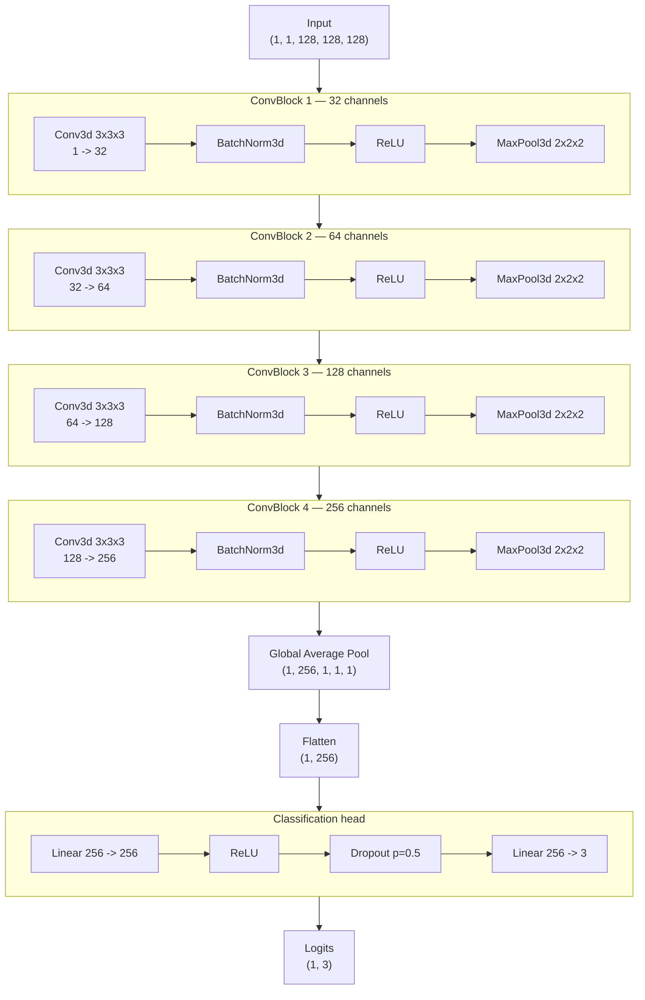

# CNN Architecture — `ConvNetClassifier`

Status: **Phase 4 — model architecture implemented.** Training loop, loss functions, and
optimization are not implemented yet (next phase). Nothing below is a trained model or a
performance claim — it documents architecture only. See
[`docs/TECHNICAL_SPECIFICATION.md`](TECHNICAL_SPECIFICATION.md) §0, §5.

All numbers on this page (parameter count, MACs/FLOPs, tensor shapes) were produced by
actually building the model and running `ad-mri model summary --model-config
configs/model/cnn3d_default.yaml` — see [Verification](#verification) at the end. Nothing
here is estimated by hand.

## 1. Overview

`ConvNetClassifier` ([`src/ad_mri/modeling/architectures.py`](../src/ad_mri/modeling/architectures.py))
is a configurable, progressively-deeper 2D/3D CNN classifier:

```
[ConvBlock] x num_blocks  ->  Global Average Pool  ->  Flatten  ->  FC head
```

Every structural parameter — depth, channel widths, kernel size, normalization, activation,
dropout, classifier width, weight init — comes from
[`ModelConfig`](../src/ad_mri/modeling/model_config.py)
([`configs/model/cnn3d_default.yaml`](../configs/model/cnn3d_default.yaml)); nothing is a
literal in the architecture code, and `num_classes` has **no default** — it must be set
explicitly from the target dataset's label taxonomy (Requirement: "do not hardcode
dataset-specific assumptions").

`spatial_dims` (2 or 3) is resolved via MONAI's dimension-agnostic layer factories
(`Conv`/`Norm`/`Pool`), so the same `ConvBlock` implementation serves both 2D slice-based and
3D volumetric models — there is one code path, not a duplicated 2D/3D branch.

## 2. Input shape

| | |
|---|---|
| Tensor layout | `(batch, in_channels, *spatial_dims)` |
| Default (`cnn3d_default.yaml`) | `(batch, 1, 128, 128, 128)` — single-channel (T1w) 3D volume |
| Configurable via | `ModelConfig.spatial_dims` (2 or 3), `.in_channels`, `.input_shape` |
| Must match | `configs/preprocessing/*.yaml`'s `target_shape` (Phase 3) |

The input shape must be large enough that `num_blocks` pooling stages (each halving spatial
resolution) don't collapse an axis to zero — `ModelConfig` validates this explicitly at
config-load time (`min(input_shape) >= pool_kernel_size ** num_blocks`) rather than failing
opaquely inside a forward pass.

Because the classifier uses **global average pooling** (not a flatten of a fixed spatial
size), the network is shape-agnostic beyond that minimum: an input larger or smaller than
`input_shape` produces the same output shape (verified in
[`tests/unit/test_architectures.py::test_forward_pass_is_shape_agnostic_thanks_to_global_average_pooling`](../tests/unit/test_architectures.py)).
`input_shape` in the config is therefore documentation + what the summary/FLOPs utility uses
for its dummy forward pass, not a hardcoded architectural constraint.

## 3. Architecture diagram

Default config: 4 blocks, channels double each block (32 → 64 → 128 → 256), input
`(1, 1, 128, 128, 128)`, 3 output classes.



Each `ConvBlock` is, in order: **Conv → Norm → Activation → [Dropout] → [Pool]** — see
`ConvBlock.forward` in `architectures.py`. Dropout is omitted by default in the feature
extractor (`dropout_conv: 0.0`) and present only in the classifier head
(`dropout_fc: 0.5`), a common design for CNN classifiers on small-to-medium medical imaging
datasets: aggressive regularization where the parameter density is highest (the FC head) and
none in the convolutional feature extractor, where batch normalization already regularizes.

## 4. Layer-by-layer explanation

| Stage | Layers | Purpose |
|---|---|---|
| **ConvBlock 1-4** | `Conv{2d,3d} → {Batch,Instance}Norm → Activation → [Dropout] → MaxPool` | Progressively deeper feature extraction: each block doubles channel capacity (more feature detectors) while pooling halves spatial resolution (larger receptive field per parameter, fewer voxels to process downstream). Normalization stabilizes/accelerates training; the activation introduces non-linearity; pooling provides local spatial invariance and downsampling. |
| **Global Average Pool** | `AdaptiveAvgPool{2d,3d}(1)` | Collapses each channel's remaining spatial map to a single value. Makes the model robust to the exact input resolution (no hardcoded flatten size) and sharply reduces the classifier head's parameter count vs. flattening the full feature map. |
| **Flatten** | `nn.Flatten()` | `(batch, C, 1, 1, 1) -> (batch, C)` — a 1D feature vector per sample. |
| **FC head** | `Linear(C, hidden) → Activation → Dropout → Linear(hidden, num_classes)` | Maps the pooled feature vector to class logits. Dropout here is the primary regularizer against overfitting on a typically small labeled medical-imaging dataset. |

Normalization/activation/dropout/pooling choices are each independently configurable
(`ModelConfig.normalization`, `.activation`, `.dropout_conv`/`.dropout_fc`,
`.pool_kernel_size`) — the table above describes the *default* config's choices, not
architectural constants.

### Weight initialization

`ConvNetClassifier._initialize_weights()` runs once at construction, applied uniformly
rather than left to PyTorch's per-layer defaults:

- **Conv/Linear weights**: Kaiming (He) normal, `mode="fan_out", nonlinearity="relu"` by
  default (appropriate for the ReLU-family activations used here) — or Xavier (Glorot) normal
  if `weight_init: xavier` is configured.
- **Conv/Linear biases**: zero-initialized.
- **Normalization layers** (BatchNorm/InstanceNorm): weight (scale) = 1, bias (shift) = 0 —
  starts as an identity transform.

## 5. Tensor shape flow

Captured from an actual forward pass (`ad-mri model summary`, `configs/model/cnn3d_default.yaml`,
batch size 1) — **not hand-computed**:

```
Input                                        (1,   1, 128, 128, 128)

feature_blocks.0.conv      (Conv3d)          (1,  32, 128, 128, 128)
feature_blocks.0.norm      (BatchNorm3d)     (1,  32, 128, 128, 128)
feature_blocks.0.activation(ReLU)            (1,  32, 128, 128, 128)
feature_blocks.0.pool      (MaxPool3d)       (1,  32,  64,  64,  64)

feature_blocks.1.conv      (Conv3d)          (1,  64,  64,  64,  64)
feature_blocks.1.norm      (BatchNorm3d)     (1,  64,  64,  64,  64)
feature_blocks.1.activation(ReLU)            (1,  64,  64,  64,  64)
feature_blocks.1.pool      (MaxPool3d)       (1,  64,  32,  32,  32)

feature_blocks.2.conv      (Conv3d)          (1, 128,  32,  32,  32)
feature_blocks.2.norm      (BatchNorm3d)     (1, 128,  32,  32,  32)
feature_blocks.2.activation(ReLU)            (1, 128,  32,  32,  32)
feature_blocks.2.pool      (MaxPool3d)       (1, 128,  16,  16,  16)

feature_blocks.3.conv      (Conv3d)          (1, 256,  16,  16,  16)
feature_blocks.3.norm      (BatchNorm3d)     (1, 256,  16,  16,  16)
feature_blocks.3.activation(ReLU)            (1, 256,  16,  16,  16)
feature_blocks.3.pool      (MaxPool3d)       (1, 256,   8,   8,   8)

global_pool                (AdaptiveAvgPool3d) (1, 256,  1,   1,   1)
flatten                    (Flatten)         (1, 256)

classifier.0                (Linear 256->256) (1, 256)
classifier.1                (ReLU)            (1, 256)
classifier.2                (Dropout)         (1, 256)
classifier.3                (Linear 256->3)   (1,   3)   <- output logits
```

Every block halves each spatial axis (128 → 64 → 32 → 16 → 8) while doubling channel count
(32 → 64 → 128 → 256) — the "progressively deeper feature extraction" requirement: less
spatial detail retained per layer, more distinct learned features per remaining voxel.

## 6. Parameter count

From the same real run:

| | |
|---|---|
| **Total parameters** | **1,229,603** |
| Trainable | 1,229,603 |
| Non-trainable | 0 |

Per-stage breakdown (params are dominated by the convolutions and the first FC layer):

| Layer | Param # |
|---|---:|
| Block 1 conv (1→32, 3×3×3) + norm | 864 + 64 |
| Block 2 conv (32→64, 3×3×3) + norm | 55,296 + 128 |
| Block 3 conv (64→128, 3×3×3) + norm | 221,184 + 256 |
| Block 4 conv (128→256, 3×3×3) + norm | 884,736 + 512 |
| FC1 (256→256) | 65,792 |
| FC2 (256→3) | 771 |
| **Total** | **1,229,603** |

## 7. Complexity estimate (MACs/FLOPs)

Analytical estimate (Conv/Linear layers only — the dominant cost; norm/activation/pooling
ops aren't counted), computed by `modeling.summary.summarize_model` via forward hooks during
the same real run — see [`modeling/summary.py`](../src/ad_mri/modeling/summary.py):

| | |
|---|---:|
| Estimated MACs | 27,179,156,224 (~27.2 GMac) |
| Estimated FLOPs (2 × MACs) | 54,358,312,448 (~54.4 GFLOP) |

For a single `(1, 128, 128, 128)` volume. This is a *rough* complexity indicator (useful for
comparing configurations or estimating inference cost order-of-magnitude), not a substitute
for actual profiling.

## 8. Configuration reference

[`configs/model/cnn3d_default.yaml`](../configs/model/cnn3d_default.yaml):

```yaml
version: "1.0.0"
architecture: convnet
spatial_dims: 3
in_channels: 1
input_shape: [128, 128, 128]
num_classes: 3          # must match your dataset's label taxonomy — no library default
num_blocks: 4
base_channels: 32
channel_growth: double  # double | linear | custom (+ explicit `channels: [...]`)
conv_kernel_size: 3
pool_kernel_size: 2
normalization: batch    # batch | instance | none
activation: relu        # relu | leaky_relu | prelu | gelu
dropout_conv: 0.0
fc_hidden_dim: 256
dropout_fc: 0.5
weight_init: kaiming     # kaiming | xavier
```

`ModelConfig.compute_hash()` is a content-addressed fingerprint of the fully resolved
config, saved alongside model checkpoints (`modeling.checkpoint.save_checkpoint`) so a
trained model can always be traced back to the exact architecture that produced it — see
`modeling/checkpoint.py` and `modeling/model_config.py`.

## 9. Extending the architecture registry

New architectures register under a name via a class decorator and become selectable purely
through `ModelConfig.architecture` — no call-site changes:

```python
from ad_mri.modeling.architectures import register_architecture

@register_architecture("my_new_cnn")
class MyNewCNN(nn.Module):
    def __init__(self, config: ModelConfig) -> None: ...
    def forward(self, x): ...
```

## Verification

- `pytest tests/unit/test_model_config.py tests/unit/test_architectures.py tests/unit/test_model_summary.py tests/unit/test_checkpoint.py`
  — 40+ tests, including an exact hand-computed parameter-count/MACs check
  (`test_model_summary.py`) that the estimator is verified against, not just "some positive
  number."
- `ad-mri model summary --model-config configs/model/cnn3d_default.yaml` — the command that
  produced every number on this page.
