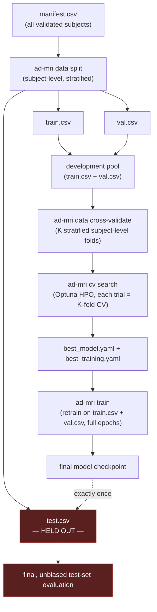

# Model Selection & Hyperparameter Optimization

Status: **Phase 6 — cross-validation and HPO implemented.** (Standalone test-set evaluation,
referenced below, is implemented in Phase 7 — see
[`docs/evaluation.md`](evaluation.md).) No performance number in this
document is a claim about real-world accuracy — everything here is a methodology description,
verified with synthetic data in tests. See
[`docs/TECHNICAL_SPECIFICATION.md`](TECHNICAL_SPECIFICATION.md) §0.

## 1. The four data roles — never conflated

| Role | Produced by | Used for | Touched how often |
|---|---|---|---|
| **Training set** | `ad-mri data split` → `train.csv` | Gradient updates (`Trainer._run_epoch(training=True)`) | Every epoch, every fold, every trial |
| **Validation set** | `ad-mri data split` → `val.csv` (or a CV fold's held-out subjects) | Early stopping, LR scheduling, metric reporting, hyperparameter/model selection | Every epoch, every fold, every trial |
| **Cross-validation** | `ad-mri data cross-validate` → `fold_0..fold_{k-1}/{train,val}.csv` | Robust model/hyperparameter selection — `k` independent train/val splits of the **development pool** (`train.csv` + `val.csv`, combined) | During HPO / CV-based comparison only |
| **Final test set** | `ad-mri data split` → `test.csv` | **One** final, unbiased performance estimate, after every modeling decision is frozen | Exactly once, at the very end |

The development pool is `train.csv + val.csv` **only** — `test.csv` is never an input to
`data cross-validate`, `cv run`, or `cv search` (none of those commands even accept a
`--test-manifest` flag). This is a structural guarantee, not a convention someone could forget:
there is no code path in this phase that can read the test set.



## 2. Cross-validation

`data_pipeline.cross_validation.create_cross_validation_folds` builds `K` folds from the
development pool:

- **Subject-level**: folding operates on unique `subject_id`s, never on rows — a subject with
  multiple scans always lands entirely in one fold (reuses
  `data_pipeline.splitting.assert_no_subject_leakage`, the same leakage check the Phase 2 holdout
  split uses).
- **Stratified where statistically appropriate**: `StratifiedKFold` when every class has at
  least `K` subjects; otherwise falls back to plain `KFold` with a logged warning
  (`stratified_cv_not_statistically_appropriate_falling_back`) rather than raising or silently
  producing a fold with zero members of some class.
- **Reproducible**: identical `seed` + identical input manifests always produce identical folds.

`training.cross_validation.run_cross_validation` then trains one model per fold — reusing
`Trainer` from Phase 5 completely unchanged — and summarizes the resulting validation metrics
with `evaluation.statistics.summarize_fold_metrics`:

- **Mean** and **sample standard deviation** (ddof=1) across folds.
- **95% confidence interval** via a t-distribution critical value (appropriate for the small
  fold counts typical here — not a normal/z approximation).
- Explicitly `None` (not a fabricated `0.0`) when fewer than 2 folds are available to summarize.

## 3. Hyperparameter optimization

`training.hpo.run_hyperparameter_search` runs an Optuna study; **every trial's score is a
cross-validation mean**, not a single train/val split — one lucky split can't produce a
misleadingly good trial.

**Search space** (`configs/hpo/default.yaml`, `HPOSearchSpace`) — exactly the parameters
requested:

| Parameter | Kind | Applies to |
|---|---|---|
| `learning_rate` | log-uniform range | `TrainingConfig` |
| `batch_size` | categorical | `TrainingConfig` |
| `optimizer` | categorical (adam/adamw/sgd) | `TrainingConfig` |
| `weight_decay` | log-uniform range | `TrainingConfig` |
| `dropout_fc` | uniform range | `ModelConfig` (architecture) |
| `base_channels` | categorical | `ModelConfig` (architecture) |
| `num_blocks` | categorical | `ModelConfig` (architecture) |

A sampled combination that fails `ModelConfig`'s own validation (e.g. `num_blocks` too deep for
`input_shape`) is caught (`optuna.study.optimize(..., catch=(ConfigurationError,))`) and marked a
failed trial — it does not abort the study. `Trainer` is always given a config that already
passed full validation; there's no path for an invalid model to actually train.

**Selection**: the trial with the best mean CV `metric_name` (per `metric_mode`) wins —
"a predefined validation metric," decided before the search runs, defined in
`configs/hpo/*.yaml`, never accuracy measured on the test set. `run_hyperparameter_search`
returns `best_model_config`/`best_training_config` with the winning hyperparameters applied —
except `epochs`, which stays at the *base* config's full value (`epochs_per_trial` is
deliberately short, purely to rank configurations quickly).

**MLflow tracking**: every experiment is nested three levels deep — a study run, containing one
run per trial, containing one run per fold — so every parameter/metric/artifact from Phase 5's
`Trainer` (checkpoints, training curves, confusion matrix) is preserved at the fold level, while
the trial and study levels add their own CV-summary and best-trial-selection metrics.

## 4. Comparison reports

`training.reporting.render_cv_report` / `render_hpo_report` write a markdown table + PNG plot:

- **CV report**: per-fold metric values, plus mean/std/95% CI per metric, plus a bar chart of a
  handful of headline metrics per fold with the mean overlaid.
- **HPO report**: every completed trial ranked by its objective value with its sampled
  hyperparameters, plus an optimization-history plot (each trial's value + the running best).

## 5. Reproducible experiment commands

```bash
# 1. Generate the holdout split (Phase 2) — test.csv is set aside here, once.
ad-mri data split --dataset-config configs/data/dataset_example.yaml

# 2. Build K stratified, subject-level CV folds from the development pool
#    (train.csv + val.csv). test.csv is not an input — cannot leak in.
ad-mri data cross-validate \
    --train-manifest data/splits/<name>/train.csv \
    --val-manifest data/splits/<name>/val.csv \
    --output-dir data/splits/<name>/cv \
    --n-folds 5 --seed 42

# 3a. Cross-validate ONE configuration (no search) — e.g. to sanity-check a
#     hand-picked config before committing to a full HPO run:
ad-mri cv run \
    --model-config configs/model/cnn3d_default.yaml \
    --training-config configs/training/default.yaml \
    --preprocessing-config configs/preprocessing/default.yaml \
    --cv-dir data/splits/<name>/cv \
    --run-name-prefix baseline-cv

# 3b. OR hyperparameter search — every trial scored by 5-fold CV on the same
#     development-pool folds. Writes best_model.yaml + best_training.yaml.
ad-mri cv search \
    --model-config configs/model/cnn3d_default.yaml \
    --training-config configs/training/default.yaml \
    --hpo-config configs/hpo/default.yaml \
    --preprocessing-config configs/preprocessing/default.yaml \
    --cv-dir data/splits/<name>/cv \
    --output-dir artifacts/hpo_reports/ad-mri-hpo

# 4. Retrain the selected configuration on the FULL development pool
#    (train.csv + val.csv), to full convergence.
ad-mri train \
    --model-config artifacts/hpo_reports/ad-mri-hpo/best_model.yaml \
    --training-config artifacts/hpo_reports/ad-mri-hpo/best_training.yaml \
    --preprocessing-config configs/preprocessing/default.yaml \
    --train-manifest data/splits/<name>/train.csv \
    --val-manifest data/splits/<name>/val.csv \
    --run-name final-model

# 5. Evaluate on test.csv EXACTLY ONCE, after every modeling decision above is
#    frozen. See docs/evaluation.md — this is the only command in the
#    repository that is meant to ever read test.csv.
ad-mri evaluate \
    --model artifacts/checkpoints/final-model/best.pt \
    --dataset data/splits/<name>/test.csv \
    --preprocessing-config configs/preprocessing/default.yaml \
    --output-dir artifacts/evaluation/final-model
```

Every config (`configs/model/*.yaml`, `configs/training/*.yaml`, `configs/preprocessing/*.yaml`,
`configs/hpo/*.yaml`) is versioned + content-hashed
(`ModelConfig.compute_hash()`/`TrainingConfig.compute_hash()`/etc.), and every checkpoint bundles
those hashes plus the exact train/val manifest SHA-256s used — so any result on this page's
workflow can be traced back to the exact data, config, and code that produced it.
